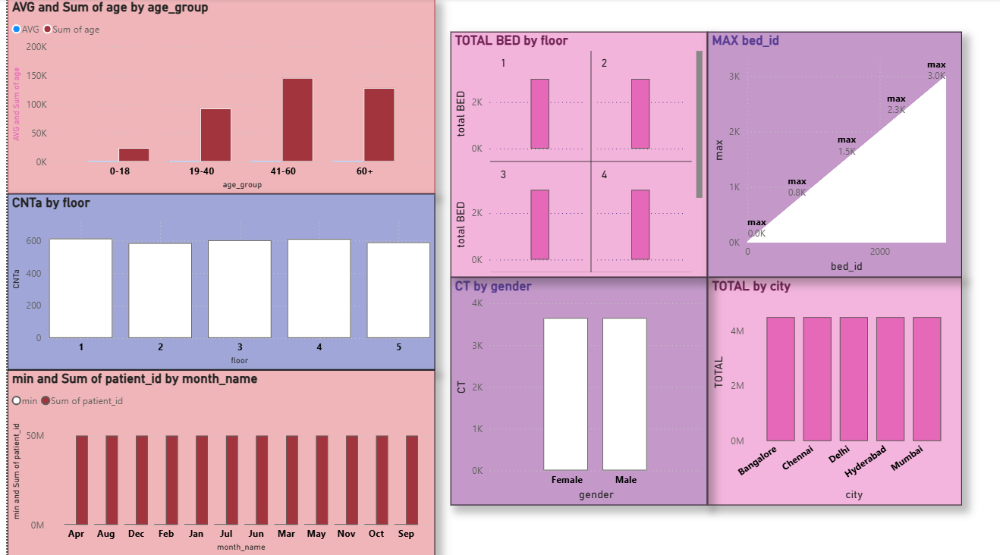
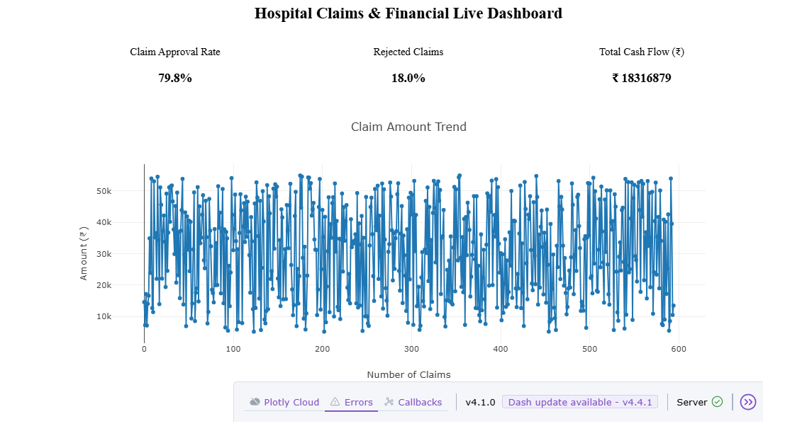
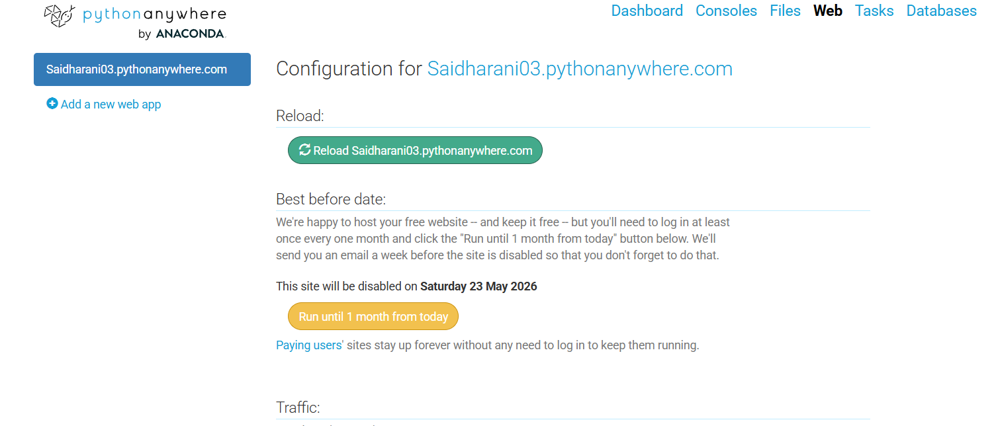
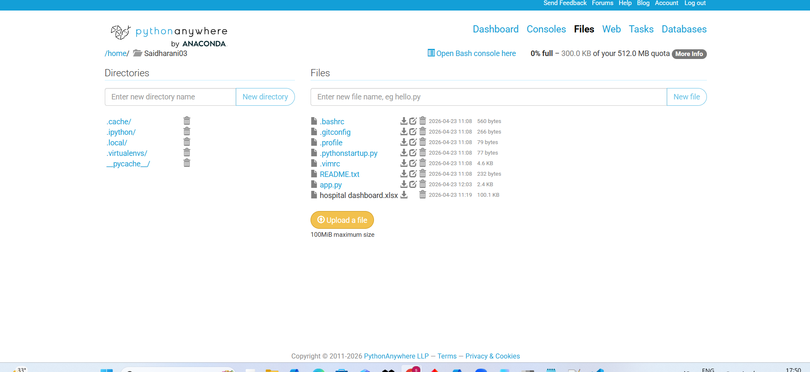

Hospital Resource Allocation and Financial Optimization
Apollo Hospitals | Business Analyst Portfolio Project

Project Type: MBA Academic Project  
Role: Business Analysis and Data Analytics  
Data Source: Secondary/reference hospital datasets  
Tools: Python, Power BI, and machine-learning techniques used in the project

1. Project Overview

This project explores how hospital operational and financial data can support resource planning and decision-making. The analysis focuses on patient flow, bed occupancy, staff utilization, waiting times, length of stay, and treatment costs.

The goal is to analyze relevant indicators, communicate findings through dashboards, and identify opportunities for improved operational monitoring.

2. Business Problem

Hospital managers need visibility into patient demand, bed capacity, staff utilization, and financial indicators. Analyzing these factors can help identify potential bottlenecks and support better-informed resource-allocation decisions.

Key business question: How can hospital operational and financial data support resource planning and performance monitoring?

3. Project Objectives

- Analyze patient flow and hospital operational indicators.
- Explore bed occupancy, waiting times, and length of stay.
- Examine staff utilization and treatment-cost indicators.
- Analyze available insurance-related financial data.
- Present selected KPIs through a Power BI dashboard.
- Explore predictive analytics for potential resource-planning applications.

4. Business Analysis

The project considers the needs of hospital management, operations managers, department managers, and finance teams.

Key business analysis activities include:
- Defining the business problem and project objectives.
- Identifying relevant stakeholders and information needs.
- Defining business requirements and KPIs.
- Interpreting data analysis results.
- Developing evidence-based recommendations.

5. Tools and Methodology

Python: Data preparation, exploratory data analysis, and analytical experiments.

Power BI: Dashboard development and visualization of selected operational and financial indicators.

Machine Learning: Predictive modelling experiments and evaluation using the methods implemented in the project.

6. Key Findings

Findings will be added after verifying the actual analytical results.

Each finding will include the observation, supporting chart or metric, business relevance, and recommendation.

7. Business Recommendations

Potential areas for further investigation include:
- Monitoring bed occupancy to support capacity planning.
- Investigating departments with longer waiting times.
- Reviewing staff workload alongside patient demand.
- Examining length-of-stay patterns.
- Tracking treatment costs and insurance-related indicators.

Recommendations will be refined using evidence from the completed analysis.

8. Project Deliverables

- Business problem and requirements analysis.
- Python-based data analysis.
- Power BI dashboard.
- Analytical findings and recommendations.
- Project documentation and limitations.

9. Data Sources and Limitations

This is an independent MBA academic case study using secondary/reference hospital data. It does not represent access to Apollo Hospitals' internal operational systems, confidential patient records, or live hospital data.

Findings and model performance are limited to the datasets, variables, and analytical methods used.

10. Project Files

- Power BI Dashboard: To be added.
- Python Analysis: To be added.

11. Conclusion

This project demonstrates an analytical approach to understanding hospital operational and financial indicators. It combines business analysis, data preparation, visualization, and analytical modelling to support evidence-based recommendations for resource planning.

Disclaimer: This is an independent academic case study and is not an official Apollo Hospitals project or representation of its internal systems.

Power BI Dashboard Preview

These dashboards showcase selected operational and financial indicators from the secondary/reference data used in this academic case study.

Dashboard 1 — Hospital Analytics

Dashboard 2 — Operational Analysis

Dashboard 3 — Additional Insights

Python Dashboard Preview

Hospital Claims & Financial Live Dashboard

This dashboard simulates hospital claims and financial monitoring, showing claim approval rate, rejected claims, total cash flow, and claim amount trends.

Python code:[View the Python dashboard code](python-analysis/hospital_claims_dashboard.py)

Note: This is a simulated dashboard based on secondary/reference data, not a live Apollo Hospitals system.

Python Live Dashboard

Dashboard Output 1

Dashboard Output 2

Note: Dashboard results are from a project simulation using secondary/reference data.

